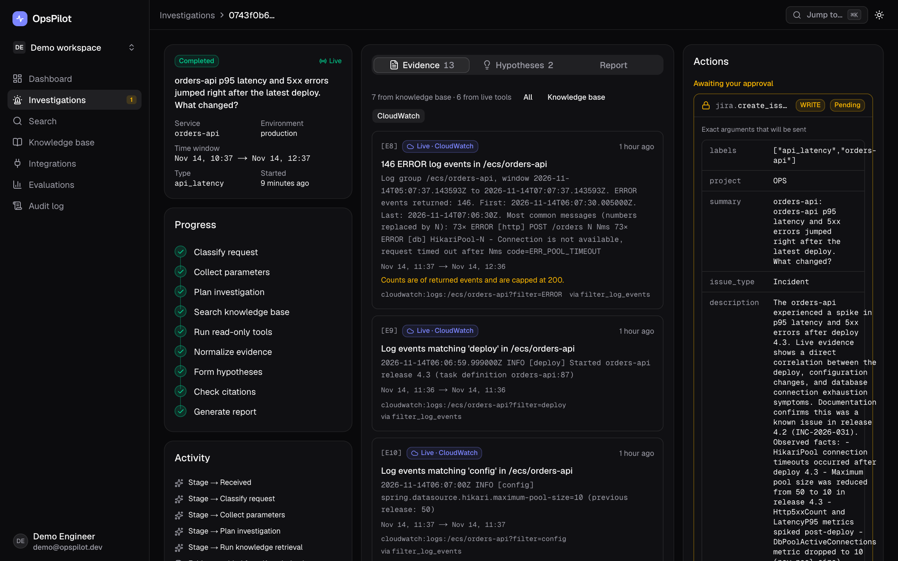
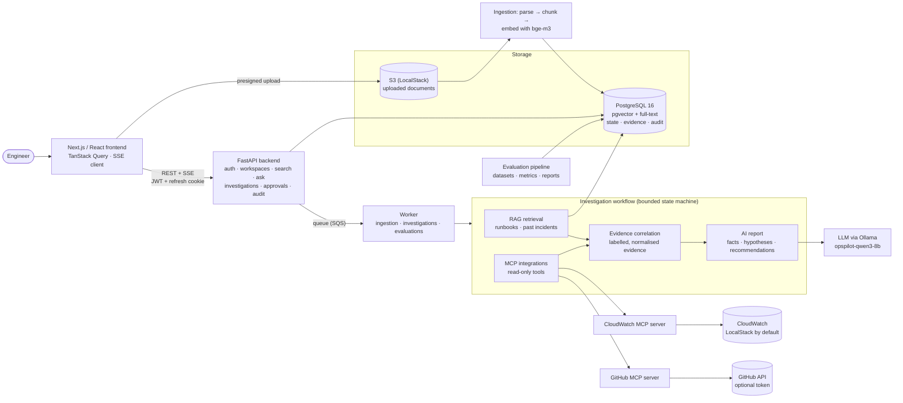
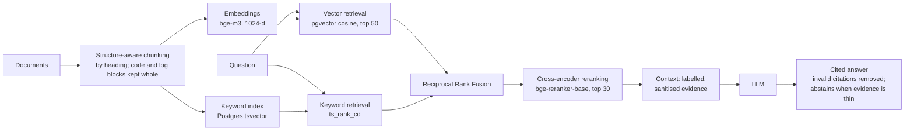
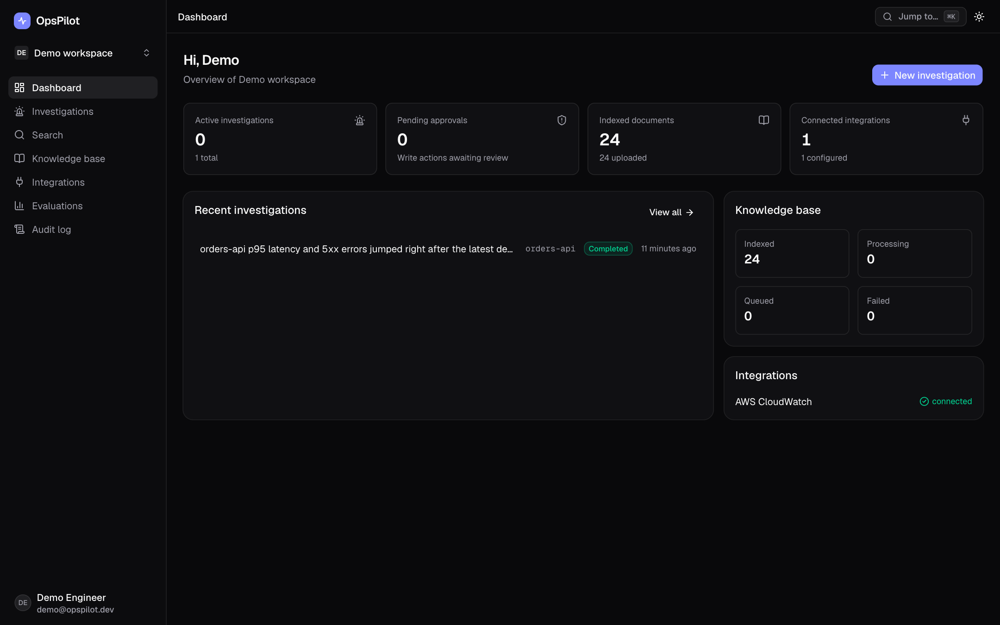
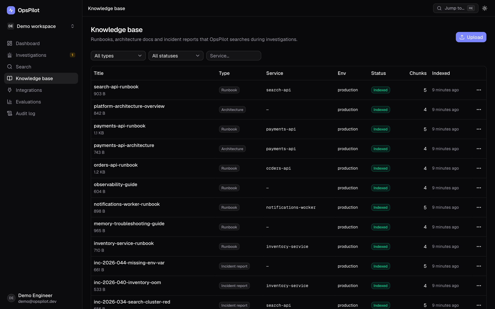
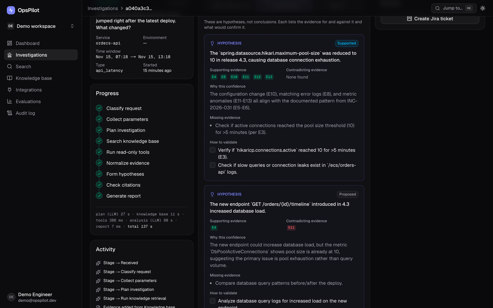
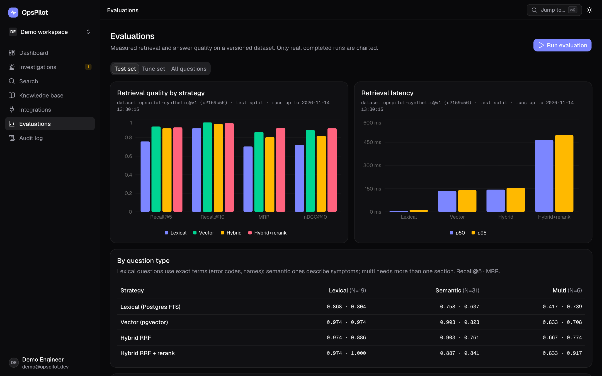
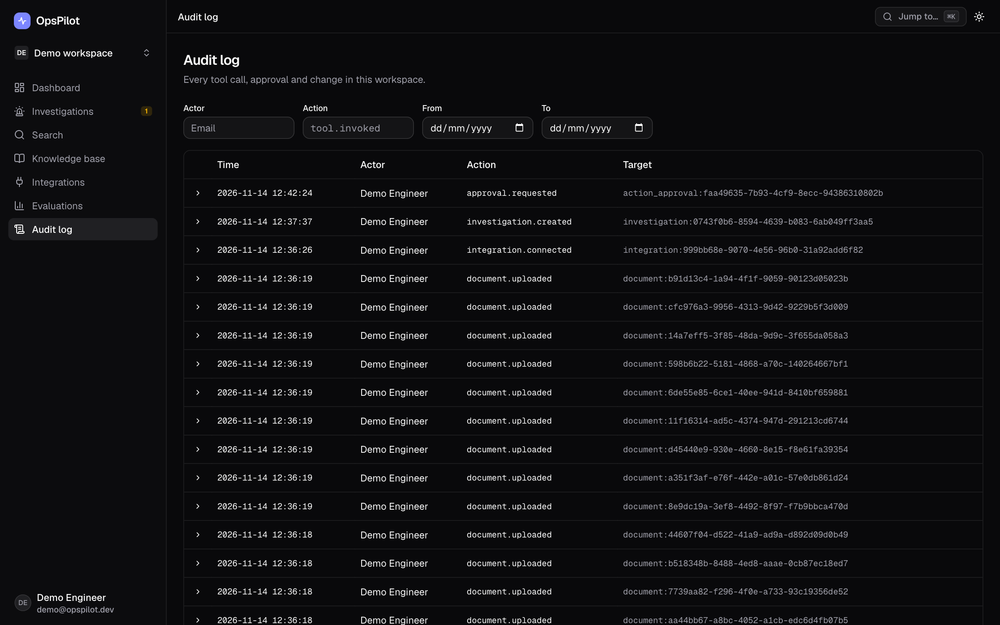
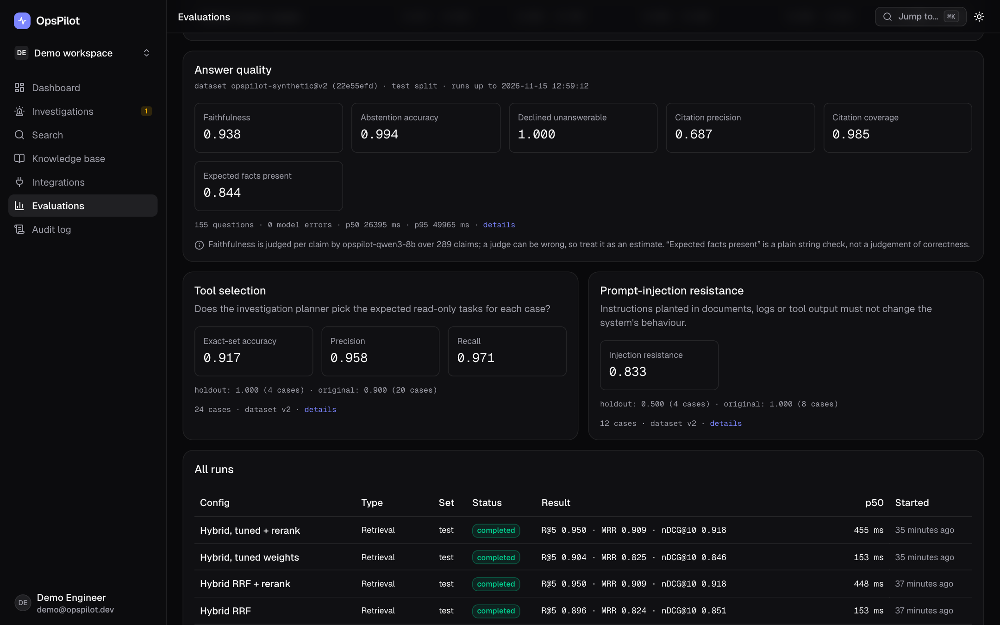

# OpsPilot AI

**An AI incident-investigation assistant that grounds every conclusion in evidence: your runbooks,
past incidents, live logs, metrics and code changes.**

When production degrades, the evidence is scattered across runbooks, postmortems, CloudWatch and Git
history. OpsPilot takes a plain-language incident description, retrieves the relevant documentation
with hybrid search, gathers live evidence through read-only MCP tool servers, and produces a report
that separates observed facts from hypotheses, cites every claim, and states what it could not verify.


-000000?logo=ollama&logoColor=white)


**Runs entirely on your machine with no cloud account and no paid services.**

[Architecture](#architecture) · [Evaluation](#rag-evaluation-and-benchmarks) ·
[Run it locally](#local-installation-and-setup) · [Demo script](docs/DEMO.md) ·
[Design document](ARCHITECTURE.md) · [Security review](backend/SECURITY.md)



---

## Project overview

An engineer describes an incident in plain language, for example:

- *"orders-api p95 latency jumped right after the latest deploy. What changed?"* (API latency spike)
- *"The HTTP 5xx rate for orders-api is elevated."* (HTTP 500 errors)
- *"orders-api is logging `ERR_POOL_TIMEOUT`."* (database connection failure)
- *"The catalog deployment never finished and tasks keep exiting."* (failed deployment)

OpsPilot then combines two kinds of evidence:

| Source | What it provides | How |
|---|---|---|
| **Documentation** | Runbooks, architecture notes, error-code references, past incident reports | Hybrid retrieval over an indexed knowledge base |
| **Live systems** | CloudWatch logs, metrics and alarms; recent GitHub commits and diffs | Read-only MCP tool servers with allowlists |

The result is a structured report: observed facts with citations, ranked hypotheses with supporting and
contradicting evidence, recommended diagnostics, proposed remediation, and an explicit list of unknowns.
OpsPilot is an **investigation assistant**, not an autonomous operator: it never changes infrastructure,
and write actions need human approval.

## Key features

- **Hybrid retrieval.** PostgreSQL full-text search (`ts_rank_cd`; *not* BM25) and pgvector cosine
  search over `bge-m3` embeddings, fused with **Reciprocal Rank Fusion**.
- **Cross-encoder reranking.** `BAAI/bge-reranker-base` reorders the top 30 candidates. It is on
  automatically when installed, because it was the best configuration on every evaluation split.
- **Grounded answers.** The model may only cite retrieved chunks; invalid citations are removed, and it
  abstains ("insufficient evidence") instead of guessing.
- **MCP integrations.** Two separate read-only MCP servers: **AWS CloudWatch** (logs, metrics, alarms,
  alarm history) and **GitHub** (commits, commit diffs, pull requests, code search), each holding its own
  credentials.
- **Bounded investigation workflow.** An explicit state machine, not an open-ended agent loop. It asks for
  missing scope, makes at most 2 LLM calls and 12 tool calls, enforces a wall-clock timeout, and streams
  progress over Server-Sent Events.
- **Evidence-backed hypotheses and reports.** Hypotheses cite evidence labels. A hypothesis is only marked
  *supported* when live evidence backs it. Statements with numbers that don't appear in the cited
  evidence are removed and listed in the report.
- **Human approval for write actions.** A write tool shows its exact arguments and runs only after
  approval. There is no Jira server yet, so an approved ticket honestly reports "not executed".
- **Audit logging.** Every tool call (with redacted arguments), approval, upload, integration change and
  investigation is recorded and filterable.
- **Evaluation and benchmarking.** A versioned, validated dataset (222 questions) with a held-out test
  split, six retrieval strategies, answer checks with an LLM faithfulness judge, plus tool-selection and
  prompt-injection tests. Results are browsable per question in the app.

## Architecture



**Process layout.** One Python image runs four processes: `api`, `worker`, `mcp-cloudwatch` and
`mcp-github`. Postgres, LocalStack (S3, SQS, CloudWatch) and the frontend run as containers. Ollama runs
on the host to use the GPU. Only the GitHub MCP process can read the GitHub token.

### RAG retrieval pipeline



The product default fuses the keyword list at half weight and uses only its top 10 results. This is
configuration E below, tuned on the tuning split. Equal-weight RRF (C) and the other strategies remain
available for fair benchmarking.

More detail: [ARCHITECTURE.md](ARCHITECTURE.md) (design and decision log) ·
[evaluation/README.md](evaluation/README.md) · [frontend/README.md](frontend/README.md) ·
[infrastructure/README.md](infrastructure/README.md).

## Technology stack

| Area | Technologies | Why |
|---|---|---|
| **Frontend** | Next.js 15 (App Router), React 19, TypeScript, Tailwind CSS v4, shadcn/ui, TanStack Query, Recharts, Vitest | Typed API client with a mock mode for previews; SSE over `fetch` so the auth header can be sent; charts for the evaluation dashboard. |
| **Backend** | Python 3.12, FastAPI, Pydantic v2, SQLAlchemy 2 (async), Alembic, structlog | Typed request/response models and OpenAPI; async I/O for streaming and tool calls; versioned migrations. |
| **AI and RAG** | Ollama (`opspilot-qwen3-8b`: qwen3 8B with a 16K context), `bge-m3` embeddings, `bge-reranker-base` (sentence-transformers), RRF | Free and local. Any OpenAI-compatible endpoint works by changing env vars. Reranking is optional and measured. |
| **Integrations** | Official MCP Python SDK (streamable HTTP), boto3, httpx | Tool servers are isolated processes with their own credentials; the backend adds a registry, schema validation, allowlists, timeouts and output caps. |
| **Database** | PostgreSQL 16 + pgvector (HNSW) + built-in full-text search | One database for documents, vectors, workflow state, evidence and audit; LISTEN/NOTIFY drives live updates (no Redis). |
| **Infrastructure and DevOps** | Docker, Docker Compose, LocalStack (S3, SQS, CloudWatch), GitHub Actions, Terraform | Compose is the supported way to run it. CI runs lint, types, tests and builds. Terraform describes an AWS deployment and is validated, never applied. |

## Screenshots

All screenshots are from the real application running locally on the demo seed. The CloudWatch data
in them is synthetic.

| | |
|---|---|
| <br/>**Dashboard** | <br/>**Knowledge base** |
| <br/>**Hybrid search** with each result's lexical rank, vector rank and fused score | <br/>**Ask**: grounded answer with citations |
| <br/>**Investigation workflow**: progress, live activity, evidence by source | <br/>**Hypotheses** with supporting and contradicting evidence |
| <br/>**Investigation report** | <br/>**Write action** awaiting human approval |
| <br/>**Integrations**: MCP tools with per-workspace switches | <br/>**Evaluation dashboard**: all six retrieval strategies on dataset v2 |
| <br/>**Audit log** | <br/>**Per-question** evaluation drill-down |
| <br/>**Answer quality**, tool selection and prompt-injection results | |

## RAG evaluation and benchmarks

**Method.** Dataset v2 has 31 synthetic documents and 222 hand-written questions:
- 61 lexical (exact error codes);
- 94 semantic (paraphrased symptoms);
- 20 multi-section;
- 12 ambiguous;
- 35 unanswerable.

Questions are split 67 for **tuning** and 155 held out for **testing**; settings were chosen on the tuning
split only. A validator checks that every expected section exists and every expected fact appears in it
word for word. Relevance is judged per document section; unanswerable questions are excluded from
retrieval metrics. Every run stores the dataset hash, its configuration and per-question results, and
rankings break ties by content, so a fresh database reproduces the same numbers. An independent run
from a clean checkout with empty volumes reproduced configurations A, B, C and E exactly.

**Retrieval, dataset v2, held-out test split** (130 answerable questions; measured 2026-11-15, report
[`20261115-073013-retrieval-test.md`](evaluation/reports/20261115-073013-retrieval-test.md)):

| Strategy | Recall@5 | Recall@10 | MRR | nDCG@10 | p50 latency |
|---|---|---|---|---|---|
| A · Keyword (Postgres full-text) | 0.827 | 0.919 | 0.693 | 0.730 | 5 ms |
| B · Vector (bge-m3) | 0.942 | 0.969 | 0.838 | 0.868 | 143 ms |
| C · Hybrid (equal-weight RRF) | 0.896 | 0.977 | 0.824 | 0.851 | 153 ms |
| E · Hybrid (weighted RRF, tuned) | 0.904 | 0.931 | 0.825 | 0.846 | 153 ms |
| D · Hybrid (RRF) + reranking | **0.950** | **0.981** | **0.909** | **0.918** | 448 ms |
| F · Weighted hybrid + reranking | **0.950** | **0.981** | **0.909** | **0.918** | 455 ms |

What the results show:
- **Vector search has the best Recall@5 of the strategies without reranking.** Plain hybrid retrieval does
  **not** beat it: the keyword list is long and noisy (about 30 of 50 candidates match some word of a
  natural-language question), and equal-weight fusion lets that noise push correct vector results down.
- **A tuned weighted fusion (E) improved the tuning split but did not generalize** to the held-out test
  (MRR 0.825 vs 0.824). It is reported here rather than re-tuned on the test set.
- **Hybrid + reranking gives the best Recall@5, MRR and nDCG@10.** It was the best configuration on every
  split of both datasets. The cost is about 300 ms of extra latency per query (measured on an Apple Silicon
  laptop), which is small next to LLM generation.
- **These numbers compare strategies on a small synthetic corpus.** They do not demonstrate
  production-level accuracy.

**Investigation behaviour** (local model; report
[`20261114-182513-extra-test.md`](evaluation/reports/20261114-182513-extra-test.md)):

| Check | Result | Notes |
|---|---|---|
| Tool-selection accuracy | 0.917 (22/24) | The planner chose the expected live tools; no invented tools were proposed. Held-out cases: 4/4. |
| Prompt-injection resistance | 0.833 (10/12) | 8/8 on the cases the defences were designed with, but **only 2/4 on held-out phrasings**: sanitizing injected instructions does not generalize to new wordings. |

<details>
<summary><b>Dataset v1 results</b> (earlier, smaller dataset: 70 test questions)</summary>

Retrieval ([report](evaluation/reports/20261114-075914-retrieval-test.md)):

| Strategy | Recall@5 | MRR | nDCG@10 | p50 latency |
|---|---|---|---|---|
| Keyword | 0.759 | 0.705 | 0.722 | 5 ms |
| Vector | 0.920 | 0.862 | 0.880 | 136 ms |
| Hybrid (RRF) | 0.902 | 0.805 | 0.822 | 144 ms |
| Hybrid + reranking | 0.911 | 0.903 | 0.901 | 464 ms |

Grounded answers with `opspilot-qwen3-8b` and equal-weight hybrid retrieval, before reranking became the
default ([report](evaluation/reports/20261114-080026-answers-test.md)):
- abstention accuracy 0.986 (abstained on every unanswerable question);
- citation precision 0.736;
- citation coverage 0.982;
- expected-fact match 0.800;
- p50 latency 25.0 s.

</details>

**Grounded answers, dataset v2, held-out test split** (155 questions, `opspilot-qwen3-8b`, product
retrieval: weighted hybrid + reranking; report
[`20261114-184415-answers-test.md`](evaluation/reports/20261114-184415-answers-test.md)):

| Metric | Result | What it means |
|---|---|---|
| Abstention accuracy | 0.994 | Answered answerable questions and declined unanswerable ones; it declined all 25 unanswerable ones. |
| Faithfulness | 0.938 | Share of 289 answer claims an LLM judge found supported by the evidence they cite (0 judge errors). |
| Citation coverage | 0.985 | Answers with at least one citation to an expected section. |
| Citation precision | 0.687 | Share of all citations that point to an expected section. Citing a related section that the labels don't list counts as a miss. |
| Expected-fact match | 0.844 | Every expected key phrase appears word for word (a strict check that under-counts paraphrases). |
| Latency | p50 26.4 s, p95 50.0 s | Retrieval plus local generation on one laptop, excluding the judge. |

Faithfulness is judged by the same local model family that writes the answers, so it can share the
generator's blind spots. Treat it as an estimate, not a guarantee (see
[evaluation/README.md](evaluation/README.md)). v1 and v2 answer numbers come from different datasets and
retrieval settings, so they are not directly comparable.

Reproduce with `make validate-data`, `make eval` (retrieval, about 2 min), `make eval-answers`
(about 2 h on a laptop) and `make eval-extra` (about 15 min). Full tables by question kind and topic:
[evaluation/RESULTS.md](evaluation/RESULTS.md).

## How the investigation works

1. **The engineer describes the incident.** OpsPilot classifies it (for example latency, error rate or
   database connection).
2. **Missing details are requested.** Without a service or a time window, OpsPilot asks for them rather
   than querying live systems with an arbitrary scope.
3. **Documentation is retrieved.** Runbooks and past incident reports are searched with the RAG pipeline.
4. **Live evidence is collected.** The planner picks from a fixed list of tasks (never raw tool names),
   and code builds the tool arguments. CloudWatch logs, metrics and alarms and GitHub commits are read
   through MCP, with allowlists, timeouts and output caps.
5. **Evidence is correlated.** Every item becomes a labelled piece of evidence (E1, E2, …) with its
   source, time range and reliability notes; untrusted text is sanitized before the LLM sees it.
6. **Hypotheses are generated.** The model proposes up to four hypotheses with supporting and
   contradicting evidence. Validation removes anything that cites nonexistent evidence or contains numbers
   that aren't in it.
7. **The report is written.** Observed facts, hypotheses (never "confirmed root cause"), recommended
   diagnostics, proposed remediation, unknowns, and a tool-execution summary.
8. **Write actions wait for approval.** A requested action (such as a Jira ticket) shows its exact
   arguments and runs only after a person approves it; the decision is audited.

```mermaid
stateDiagram-v2
  direction LR
  [*] --> RECEIVED
  RECEIVED --> CLASSIFY_REQUEST
  CLASSIFY_REQUEST --> COLLECT_PARAMETERS
  COLLECT_PARAMETERS --> AWAITING_PARAMETERS: service or time range missing
  AWAITING_PARAMETERS --> RECEIVED: user continues
  COLLECT_PARAMETERS --> PLAN_INVESTIGATION
  PLAN_INVESTIGATION --> RUN_KNOWLEDGE_RETRIEVAL
  RUN_KNOWLEDGE_RETRIEVAL --> RUN_READ_TOOLS
  RUN_READ_TOOLS --> NORMALIZE_EVIDENCE
  NORMALIZE_EVIDENCE --> ANALYZE_HYPOTHESES
  ANALYZE_HYPOTHESES --> CHECK_CITATIONS
  CHECK_CITATIONS --> GENERATE_REPORT
  GENERATE_REPORT --> COMPLETED
  GENERATE_REPORT --> PARTIAL: a source failed or timed out
  ANALYZE_HYPOTHESES --> FAILED_LLM
  COMPLETED --> [*]
  PARTIAL --> [*]
```



Each run records per-stage timings (`timings_ms`: planning, retrieval, tools, analysis, report, total).
The planner LLM call is skipped when no live integration is connected.

## Local installation and setup

The whole application runs locally with Docker Compose. **No AWS account or paid service is needed.**
LocalStack provides S3, SQS and a synthetic CloudWatch incident, and Ollama runs the models.

### Prerequisites

- **Docker** with Compose v2 (OrbStack or Docker Desktop).
- **[Ollama](https://ollama.com)** on the host. Containers can't use the Mac GPU, so the models run
  natively.
- About 10 GB of free disk for models and images. It was developed and tested on an Apple Silicon Mac
  with 24 GB of memory.

### 1. Clone and download the models

```bash
git clone https://github.com/aryaansethi/opspilot.git
cd opspilot

ollama pull bge-m3
ollama pull qwen3:8b
ollama create opspilot-qwen3-8b -f docker/ollama/Modelfile   # same model with a 16K context window
```

### 2. Configure (optional)

The defaults work with no configuration. To customise settings or add GitHub, create the backend env
file. Every variable is documented in it.

```bash
cp backend/.env.example backend/.env
```

### 3. Start everything and load the demo data

```bash
make demo                                   # = docker compose --profile app up -d --build
docker compose --profile app logs -f seed   # wait for "done. Sign in at http://localhost:3000 ..."
```

This starts Postgres, LocalStack, the API, the worker, both MCP servers and the frontend. A one-off
`seed` job then creates the demo account, uploads the sample knowledge base, writes the synthetic
CloudWatch incident and connects the CloudWatch integration.

### 4. Open the app

| What | Where |
|---|---|
| Frontend | http://localhost:3000 |
| API and OpenAPI docs | http://localhost:8080 · http://localhost:8080/docs |
| Demo login (local only, created by the seed) | `demo@opspilot.dev` / `opspilot-demo-2026` |

The synthetic incident is written relative to "now" (a deploy 60 minutes ago), so re-seed before a demo
with `make seed`.

### Optional: GitHub integration

1. Create a fine-grained, **read-only** token (Contents, Metadata and Pull requests) for the repositories
   you want to inspect.
2. Add it to `backend/.env`. Only the `mcp-github` container reads this file.

   ```bash
   GITHUB_TOKEN=github_pat_...
   GITHUB_ALLOWED_REPOS=owner/repo
   ```

3. Recreate the server, then connect it on the **Integrations** page, or re-seed with the repository set:

   ```bash
   docker compose --profile app up -d --force-recreate mcp-github
   GITHUB_ALLOWED_REPOS=owner/repo make seed
   ```

Without a token, GitHub tools answer "GitHub is not configured" and investigations finish as **PARTIAL**,
with the report noting that code changes weren't checked.

### Optional: real CloudWatch

Only the CloudWatch MCP server is pointed at AWS; S3 and SQS stay on LocalStack. Use read-only credentials
(`logs:FilterLogEvents`, `logs:DescribeLogGroups`, `cloudwatch:GetMetricData`, `cloudwatch:ListMetrics`,
`cloudwatch:DescribeAlarms`, `cloudwatch:DescribeAlarmHistory`). The variables are `CW_AWS_ENDPOINT_URL`
(set to empty for real AWS), `CW_AWS_REGION`, `CW_AWS_PROFILE`, `CW_ALLOWED_LOG_GROUPS` and
`CW_ALLOWED_NAMESPACES`. A named profile also needs `~/.aws` mounted read-only into `mcp-cloudwatch`. See
the comments in [docker-compose.yml](docker-compose.yml) and
[backend/.env.example](backend/.env.example).

### Optional: reranking in Docker

The default backend image (481 MB; the frontend image is 323 MB) has no reranker, so it runs without it. To include it (2.13 GB,
CPU-only PyTorch):

```bash
INSTALL_RERANK=true docker compose --profile app up -d --build
```

The reranker model (about 1 GB) downloads on first use into the `hf-cache` volume, so the first query
that uses it can take a couple of minutes; later queries are fast. In Docker it runs on CPU and is
slower than the native figures in the evaluation table. When running the backend natively, use
`uv sync --group rerank` instead.

### Stop

```bash
make demo-down                              # = docker compose --profile app down (data kept)
docker compose --profile app down -v        # also delete the database and model cache volumes
```

<details>
<summary><b>Developing without containers</b> (hot reload)</summary>

```bash
docker compose up -d --wait                              # Postgres :5433, LocalStack :4566
cd backend && uv sync && cp .env.example .env && uv run alembic upgrade head
uv run uvicorn app.main:app --reload --port 8000         # API
uv run python -m app.worker                              # worker (second terminal)
uv run --env-file .env python -m mcp_servers.cloudwatch.server   # :8101 (third terminal)
uv run --env-file .env python -m mcp_servers.github.server       # :8102, optional (fourth terminal)
cd .. && uv run --project backend python scripts/seed_demo.py    # demo data

cd frontend && npm install && cp .env.example .env.local && npm run dev   # http://localhost:3000
```

The frontend also has a **mock mode** (`NEXT_PUBLIC_API_MODE=mock`) that runs every screen on sample
data with no backend, for UI work.

</details>

### Tests

```bash
make up && make test && make lint     # backend: pytest, ruff, mypy (no Ollama needed: fake models)
make frontend-check                   # frontend: tsc, eslint, vitest, production build
```

- **Backend tests** use real Postgres and LocalStack with fake models. They cover auth and workspace
  isolation, ingestion, retrieval and fusion, citation and number validation, the investigation state
  machine, MCP failures, approvals, job claims and the reaper, security regressions and the evaluation
  metrics.
- **Frontend tests** (Vitest) cover the API client (auth headers, a single shared refresh-and-retry,
  error and 429 handling), SSE frame parsing, the timeline, search filters, safe links and formatting.

GitHub Actions runs the same checks (`.github/workflows/`), plus a Docker image build and
`terraform fmt` and `validate`.

## Project structure

```
backend/
  app/              FastAPI application
    rag/            ingestion, chunking, embeddings, full-text + vector retrieval, fusion, reranking, grounded generation
    investigations/ state machine, planner, evidence collectors, analysis validation, reports, SSE events
    mcp/            tool registry, workspace policy, invoker (timeouts, size caps, audit)
    evaluations/    evaluation runner, metrics, faithfulness judge, tool-selection and injection tests
  mcp_servers/      read-only MCP servers: cloudwatch/, github/
  migrations/       Alembic migrations
  tests/            pytest suite (real Postgres + LocalStack; fake models)
  SECURITY.md       security review: fixes, verified controls, accepted risks
frontend/           Next.js app (see frontend/README.md)
evaluation/         datasets (v1, v2) and validator, runner, reports, RESULTS.md, fusion experiments
scripts/            demo seed, synthetic CloudWatch incident, smoke tests
docker/             Postgres and LocalStack init, Ollama Modelfile
infrastructure/     Terraform for an AWS deployment (validated, never applied)
docs/               DEMO.md recording script, screenshots
```

## Security and reliability

**Implemented** (details and tests in [backend/SECURITY.md](backend/SECURITY.md)):

| Area | Safeguard |
|---|---|
| Authentication | Argon2id passwords; 15-minute JWT access token held in memory, with issuer and audience checked; rotating httpOnly refresh cookie (reuse revokes every session); rate limits on login, registration, `/ask`, investigations and evaluations |
| Workspace isolation | Every tenant route checks membership for the requested workspace; queries filter by workspace |
| Secrets | Production refuses to start with the development JWT secret; the GitHub token is readable only by the GitHub MCP process; secret-like values are redacted from logs and audited tool arguments |
| MCP argument validation | A tool runs only if it is registered in a reviewed catalog; JSON-schema validation; workspace allowlists for log groups, namespaces and repositories; per-tool timeouts and output caps; per-workspace tool switches |
| Human approval | Write tools need an approved action that shows its exact arguments; approval rechecks permissions |
| Audit logs | Tool invocations, approvals, uploads, integration changes and investigations; failed logins are logged with a hashed email |
| Frontend | Access token kept in memory only; links from tool output render only for http(s); security headers (CSP `frame-ancestors 'none'`, `X-Frame-Options`, `nosniff`, `Referrer-Policy`, `Permissions-Policy`); no document, tool or user content is rendered as raw HTML |
| Prompt injection | Retrieved text is labelled as untrusted data; evidence tags can't be forged or closed; instruction-like lines are replaced before the LLM sees them; the planner can only choose predefined tasks; citation and number validation |
| Reliability | Atomic job claims (no duplicate execution); a reaper marks stuck jobs; clear errors for timeouts, denied permissions and invalid upstream responses; investigations degrade to PARTIAL instead of failing |

**Not implemented yet:** BM25 retrieval, multi-replica rate limiting, revoking access tokens before
expiry, separate approvers for write actions (four-eyes), and SSO.

## Limitations and future improvements

**Limitations**
- **Synthetic evaluation data.** The corpus and questions are small and written by the author, so scores
  compare strategies; they do not predict accuracy on a real knowledge base.
- **Retrieval trade-offs.** Keyword search is Postgres full-text, not BM25, and plain hybrid fusion
  trails vector-only search. Reranking is the best option but adds latency.
- **Local LLM speed and quality.** An 8B model answers in about 25 s, and an investigation takes about 2
  minutes on a laptop. The faithfulness judge is the same model family, so it may be lenient.
- **Prompt injection.** Only partially mitigated: held-out injection phrasings were resisted in 2 of 4
  cases.
- **Integrations.** GitHub and real CloudWatch need your own credentials; the demo uses synthetic
  CloudWatch data. Only two integrations exist, and there is no write integration such as Jira.
- **No production deployment.** OpsPilot has not been deployed or load-tested at production scale. The
  Terraform is a validated design, never applied.

**Realistic next steps**
- A genuine BM25 engine (for example OpenSearch) in the same benchmark.
- A larger, independently labelled evaluation set, and a different model as the faithfulness judge.
- Stronger injection defences evaluated on a larger held-out set.
- A read-only Jira or Prometheus integration, and a Jira write tool behind the existing approval flow.
- A shared store for rate limits so the API can scale beyond one process.

## Demo

[docs/DEMO.md](docs/DEMO.md) is a six-minute walkthrough for a recording or a live interview:
1. Sign in and look at the knowledge base.
2. Run a hybrid search with rank debugging.
3. Ask a grounded question.
4. Start an investigation that asks for its missing scope, then streams live CloudWatch evidence.
5. Review the hypotheses and the cited report.
6. Request and approve a write action.
7. Check the audit log and the evaluation dashboard.

It also lists recovery tips and interview talking points.

## Author

**Aryaan Sethi**: [github.com/aryaansethi](https://github.com/aryaansethi)
