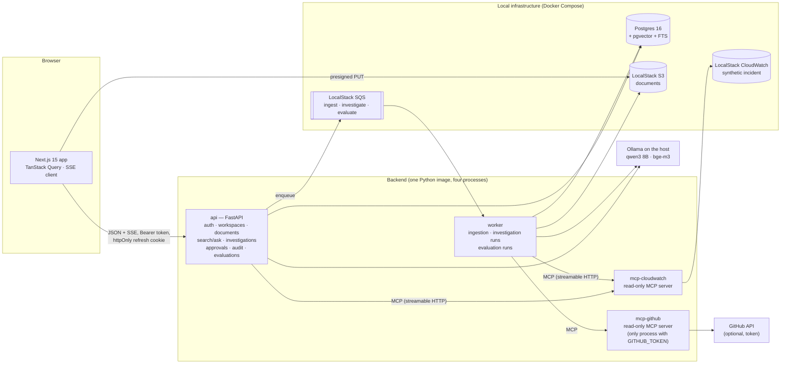
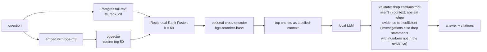
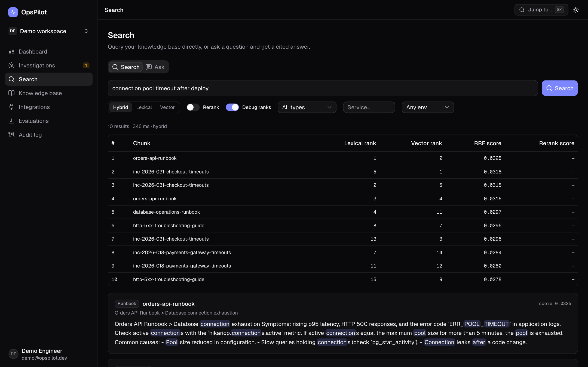
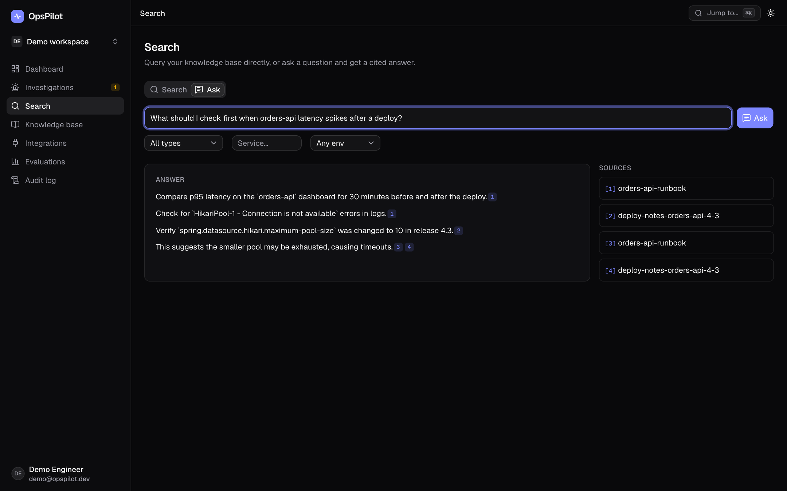
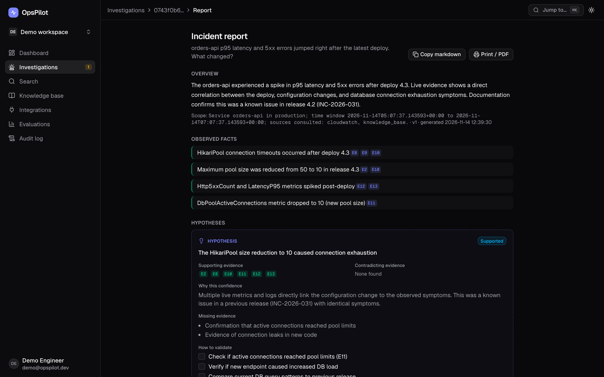
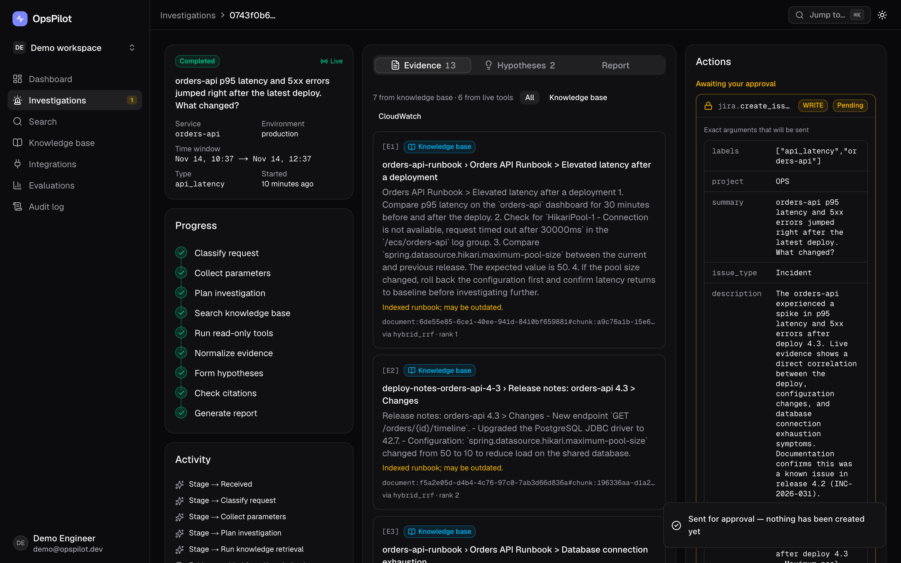
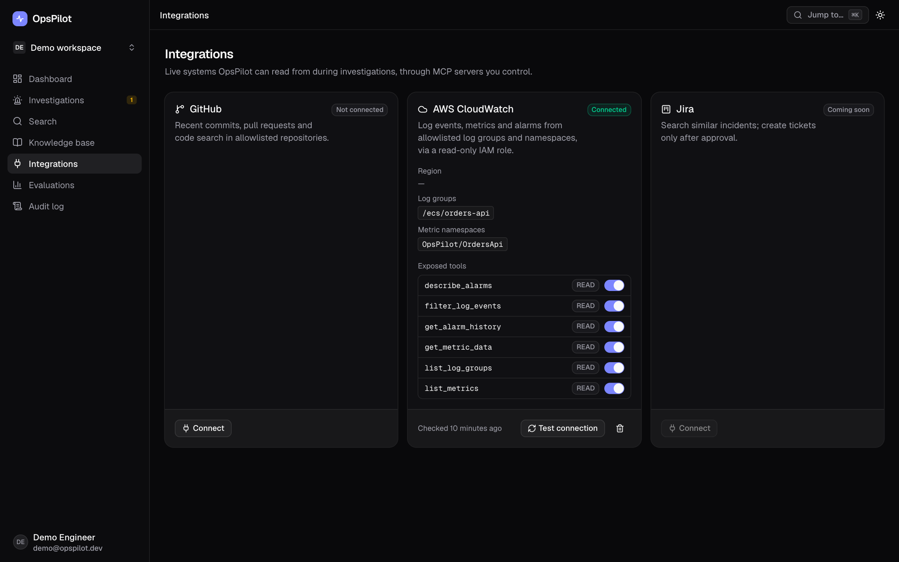
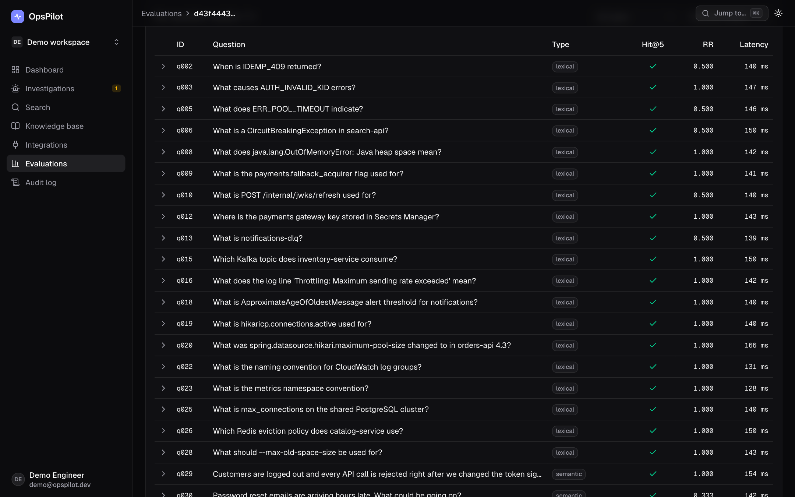

# OpsPilot AI

**An incident-investigation assistant for engineering teams.** Describe what's wrong; OpsPilot searches
your runbooks and past incidents with hybrid retrieval, gathers live evidence from GitHub and CloudWatch
through read-only MCP tool servers, and writes a report that separates observed facts from hypotheses,
cites every claim, and says what it couldn't find. Write actions (like opening a Jira ticket) only run
after a human approves the exact arguments.

Runs **entirely on your machine at zero cost**: Docker Compose (Postgres + pgvector, LocalStack for
S3/SQS/CloudWatch), Ollama for the models. No cloud account is needed; the Terraform in
`infrastructure/` is a validated, never-applied example.


- [What it does](#what-it-does) · [Architecture](#architecture) · [Tech stack](#tech-stack-and-why) ·
  [Quick start](#quick-start-docker-compose) · [Configuration](#configuration) ·
  [Evaluation](#evaluation-results-dataset-v1-held-out-test-split) · [Screenshots](#screenshots) ·
  [Demo script](docs/DEMO.md)

## What it does

| Capability | How |
|---|---|
| **Knowledge base** | Upload PDF/Markdown/TXT runbooks and postmortems. Files go to S3 through presigned URLs; an SQS worker parses, chunks by heading, embeds with `bge-m3` and indexes into pgvector + Postgres full-text. |
| **Hybrid search** | Full-text and vector search fused with Reciprocal Rank Fusion, optional cross-encoder reranking. A debug view shows every result's lexical rank, vector rank and fused score. |
| **Grounded answers** | The model may only cite retrieved chunks; invalid citations are removed, and it abstains ("insufficient evidence") instead of guessing. |
| **Investigations** | A bounded state machine: classify → collect parameters (asks if service or time range is missing) → plan → retrieve → call read-only tools → normalise evidence → hypotheses → citation and number checks → report. Progress streams live over SSE. |
| **Live evidence via MCP** | CloudWatch (logs, metrics, alarms) and GitHub (commits, PRs, code search) run as separate MCP servers with allowlists, timeouts and output caps. Each holds its own credentials. |
| **Human-approved actions** | Write tools are never called by the workflow. A request shows the exact arguments and runs only after approval; every decision is audited. |
| **Audit log** | Tool calls, approvals, uploads, integration changes and investigations, filterable by actor, action and time. |
| **Measured quality** | A versioned dataset with a held-out test split compares four retrieval strategies and grades answers (abstention, citation precision/coverage). Results are browsable per question in the app. |

## Architecture



### Investigation workflow

```mermaid
stateDiagram-v2
  direction LR
  [*] --> RECEIVED
  RECEIVED --> CLASSIFY_REQUEST
  CLASSIFY_REQUEST --> COLLECT_PARAMETERS
  COLLECT_PARAMETERS --> AWAITING_PARAMETERS: service or time range missing
  AWAITING_PARAMETERS --> RECEIVED: user continues
  COLLECT_PARAMETERS --> PLAN_INVESTIGATION
  PLAN_INVESTIGATION --> RUN_KNOWLEDGE_RETRIEVAL
  RUN_KNOWLEDGE_RETRIEVAL --> RUN_READ_TOOLS
  RUN_READ_TOOLS --> NORMALIZE_EVIDENCE
  NORMALIZE_EVIDENCE --> ANALYZE_HYPOTHESES
  ANALYZE_HYPOTHESES --> CHECK_CITATIONS
  CHECK_CITATIONS --> GENERATE_REPORT
  GENERATE_REPORT --> COMPLETED
  GENERATE_REPORT --> PARTIAL: a tool step failed
  ANALYZE_HYPOTHESES --> FAILED_LLM
  COMPLETED --> [*]
  PARTIAL --> [*]
```



Each run is capped (12 tool calls, a wall-clock timeout, output size limits). The plan step may only
choose from tasks the workspace's integrations allow; tool arguments are checked against the
integration's allowlist (log groups, namespaces, repositories) before any call.

### Hybrid retrieval and grounding



More detail: [ARCHITECTURE.md](ARCHITECTURE.md) (design and decision log),
[frontend/README.md](frontend/README.md), [evaluation/README.md](evaluation/README.md),
[infrastructure/README.md](infrastructure/README.md).

## Tech stack and why

| Layer | Choice | Why |
|---|---|---|
| Frontend | Next.js 15 (App Router), TypeScript strict, Tailwind v4, shadcn/ui, TanStack Query, Recharts | Typed API contract with a mock implementation for previews; query keys scoped per workspace; SSE via `fetch` streams so the Authorization header can be sent. |
| API | FastAPI, Pydantic v2, SQLAlchemy 2 (async), Alembic | Typed request/response models generate the OpenAPI schema; async I/O suits SSE and tool calls. |
| Retrieval | Postgres 16 full-text + pgvector, RRF, optional `bge-reranker-base` | One database for documents, vectors, state and audit; fusion and reranking are measured, not assumed. |
| Models | Ollama: `opspilot-qwen3-8b` (16K context) and `bge-m3` embeddings | Free and local. Any OpenAI-compatible endpoint works by changing env vars. |
| Async work | SQS (LocalStack) + a worker process | Uploads, investigations and evaluations never block requests; dead-letter queues catch poison messages. |
| Tools | MCP Python SDK, streamable HTTP | Tool servers are isolated processes with their own credentials; the backend adds allowlists, argument policies, timeouts and output caps. |
| Auth | Short-lived JWT access token (in memory) + rotating httpOnly refresh cookie, per-IP login/registration rate limits | No tokens in `localStorage`; refresh-token reuse revokes every session; every query is scoped to the caller's workspace. |
| Infra as code | Docker, Docker Compose, Terraform (ECS Fargate, RDS, S3, SQS) | Compose is the supported way to run it; Terraform is validated in CI and never applied. |
| CI | GitHub Actions: ruff, mypy, pytest (Postgres + LocalStack services), Docker build, frontend tsc/lint/build, `terraform validate` | Every push is checked end to end without cloud credentials. |

## Quick start (Docker Compose)

You need **Docker** (OrbStack or Docker Desktop) and **[Ollama](https://ollama.com)** on the host
(it uses the Mac's GPU, which containers can't).

```bash
# 1. models (one-time, ~6 GB)
ollama pull bge-m3
ollama pull qwen3:8b
ollama create opspilot-qwen3-8b -f docker/ollama/Modelfile   # same model, 16K context

# 2. everything else: Postgres, LocalStack, API, worker, both MCP servers, frontend, demo seed
docker compose --profile app up -d --build

# 3. watch the one-off seed finish (demo account, 24 documents, synthetic CloudWatch incident)
docker compose --profile app logs -f seed
```

Open **http://localhost:3000** and sign in with **`demo@opspilot.dev` / `opspilot-demo-2026`**
(a local demo account created by the seed). The API is on http://localhost:8080 (OpenAPI docs at
`/docs`).

The synthetic incident is written relative to "now" (a deploy 60 minutes ago), so re-seed before a
demo: `docker compose --profile app run --rm seed`. Stop with `docker compose --profile app down`
(add `-v` to delete the data).

### Developing without containers

Run the infrastructure in Compose and the apps natively, with hot reload:

```bash
docker compose up -d --wait                              # postgres :5433, localstack :4566
cd backend && uv sync && cp .env.example .env && uv run alembic upgrade head
uv run uvicorn app.main:app --reload --port 8000         # API
uv run python -m app.worker                              # worker (second terminal)
CW_ALLOWED_LOG_GROUPS=/ecs/orders-api CW_ALLOWED_NAMESPACES=OpsPilot/OrdersApi \
  uv run python -m mcp_servers.cloudwatch.server         # :8101 (third terminal)
uv run --env-file .env python -m mcp_servers.github.server   # :8102, optional (fourth terminal)
cd .. && uv run --project backend python scripts/seed_demo.py   # demo data

cd frontend && npm install && cp .env.example .env.local && npm run dev   # http://localhost:3000
```

The frontend also has a **mock mode** (`NEXT_PUBLIC_API_MODE=mock` in `frontend/.env.local`) that
runs every screen on in-memory sample data with no backend at all, for UI work and quick previews.

## Configuration

All settings are environment variables; `backend/.env.example` documents every one with a safe local
default. Nothing needs a real cloud account.

| Integration | Without credentials (default) | With credentials |
|---|---|---|
| **CloudWatch** | Reads the **synthetic** incident the seed writes into LocalStack. | Point only the CloudWatch server at real AWS: `CW_AWS_ENDPOINT_URL=` (empty), `CW_AWS_REGION`, and `CW_AWS_PROFILE` (a read-only profile) or the standard credential chain; S3/SQS stay on LocalStack. Restrict with `CW_ALLOWED_LOG_GROUPS` / `CW_ALLOWED_NAMESPACES`. The LocalStack dummy keys are never sent to AWS. |
| **GitHub** | The server starts and every tool answers "GitHub is not configured"; investigations finish **PARTIAL** and the report says recent code changes weren't checked. | Put `GITHUB_TOKEN` (fine-grained, read-only) and `GITHUB_ALLOWED_REPOS=owner/name` in `backend/.env`; only `mcp-github` reads that file. Connect it on the Integrations page, or re-run the seed with `GITHUB_ALLOWED_REPOS` set. |
| **Jira** | Approval flow works; execution reports "tool not registered". | Not implemented yet (no Jira MCP server). |
| **LLM** | Ollama on the host. | Any OpenAI-compatible endpoint: `LLM_BASE_URL`, `LLM_API_KEY`, `LLM_MODEL`, `EMBEDDING_MODEL`, `EMBEDDING_DIM`. |

## Screenshots

| | |
|---|---|
|  **Dashboard** |  **Knowledge base** |
|  **Hybrid search with rank debug** |  **Grounded answer with citations** |
|  **Hypotheses, kept separate from facts** |  **Cited report** |
|  **Write action awaiting approval** |  **MCP integrations and tool switches** |
|  **Retrieval evaluation dashboard** |  **Per-question drill-down** |

All screenshots are from the real app running locally on the demo seed. More in
[docs/screenshots](docs/screenshots); a recording script is in [docs/DEMO.md](docs/DEMO.md).

## Evaluation results (dataset v1, held-out test split)

Retrieval over 70 held-out questions (56 answerable), measured by `evaluation/run.py` on 2026-11-14
([report](evaluation/reports/20261114-061751-retrieval-test.md), [method](evaluation/README.md)):

| Config | Recall@5 | MRR | nDCG@10 | p50 latency |
|---|---|---|---|---|
| A: Postgres full-text (not BM25) | 0.786 | 0.692 | 0.713 | 4 ms |
| B: vector (bge-m3) | 0.920 | 0.862 | 0.880 | 135 ms |
| C: hybrid, RRF k=60 | 0.893 | 0.779 | 0.805 | 142 ms |
| D: hybrid + cross-encoder rerank | 0.911 | 0.903 | 0.901 | 457 ms |

Grounded answers over the same 70 questions with the local `opspilot-qwen3-8b` model
([report](evaluation/reports/20261114-061903-answers-test.md)):

| Metric | Value |
|---|---|
| Abstention accuracy (answers when it can, says "not enough evidence" when it can't) | 0.986 |
| Abstains on unanswerable questions | 1.000 |
| Citation precision (cited chunks from an expected section) | 0.726 |
| Citation coverage (answers with at least one correct citation) | 0.982 |
| Expected-fact match (strict verbatim key phrases) | 0.800 |
| Latency p50 / p95 | 22.7 s / 46.6 s |

Faithfulness is not measured yet (no LLM judge or full human grading).

What this shows: reranking gives the best ranking quality; plain equal-weight RRF is *worse* than
vector-only here because the lexical side is weak on paraphrased and multi-section questions. RRF k
(10–100) made no measurable difference on the tuning split. The corpus is small and synthetic, so
treat these as a comparison between configurations, not as production accuracy.

## Reproducing the evaluation

```bash
make eval            # retrieval configs A–D on the held-out test split (~1 min), rewrites evaluation/RESULTS.md
make eval-answers    # grounded-answer checks with the local LLM (~30 min)
make eval-results    # rebuild RESULTS.md from stored runs without re-running
```

Every run stores the dataset hash, configuration and per-question results in Postgres and
`evaluation/reports/`; the Evaluations page in the app reads the same runs. Method, metric definitions
and limitations: [evaluation/README.md](evaluation/README.md); latest numbers:
[evaluation/RESULTS.md](evaluation/RESULTS.md).

## Testing and CI

```bash
make up                  # Postgres + LocalStack (tests use a separate opspilot_test database)
make test && make lint   # backend: pytest, ruff, mypy

cd frontend && npx tsc --noEmit && npm run lint && npm run build
```

Backend tests use deterministic fake embeddings and a scripted fake LLM, so they don't need Ollama.
GitHub Actions runs the same checks on every push (`.github/workflows/`), plus a Docker build of the
backend image and `terraform fmt`/`validate`.

## Project layout

```
backend/            FastAPI app (app/), MCP servers (mcp_servers/), Alembic migrations, tests
frontend/           Next.js app; see frontend/README.md
evaluation/         versioned dataset (datasets/v1), runner, generated reports
scripts/            seed_demo.py (demo workspace), seed_cloudwatch.py (synthetic incident), smoke tests
docker/             Postgres/LocalStack init, Ollama Modelfile
infrastructure/     Terraform for AWS (validated, never applied) and its README
docs/               DEMO.md recording script, screenshots
```

## Build status

| Phase | State |
|---|---|
| 1. Auth + workspaces | Done, tested |
| 2. Document ingestion (S3 → SQS → worker) | Done, tested |
| 3. Hybrid search + grounded Q&A | Done, tested |
| 4. MCP: CloudWatch server + backend MCP layer | Done, tested |
| 4b. MCP: GitHub server | Done, tested; live check against a real repository passed |
| 5. Investigation workflow (state machine, SSE, approvals, audit) | Done, tested; live run on local model |
| 6. Evaluation (dataset v1, retrieval A–D, answer checks, dashboard) | Done; results below. Human spot-check of 20 questions pending |
| 7. CI, containers, Terraform | Done: GitHub Actions (backend, frontend, Terraform), Docker image + Compose `app` profile, Terraform validated. Not deployed (owner decision, see `infrastructure/README.md`) |
| Frontend (Next.js) | Done: all screens on the real API (mock mode for previews) |

## Honest notes

- Lexical retrieval is **PostgreSQL full-text search (`ts_rank_cd`), not BM25**. A BM25 engine (OpenSearch) is a planned, measured comparison.
- Token counts used for chunk sizing are estimates (~4 characters per token).
- No benchmark numbers are claimed until the evaluation phase produces them.
- CloudWatch data in local development is **synthetic** (`scripts/seed_cloudwatch.py`) and is labelled as such.
- LocalStack's free edition only speaks CloudWatch's older `query` protocol; `mcp_servers/aws_compat.py` pins it when an endpoint override is set. Real AWS is unaffected.
- MCP servers live in `backend/mcp_servers/` (shared dependencies) and use the official MCP Python SDK v2 (`MCPServer`, streamable HTTP).
